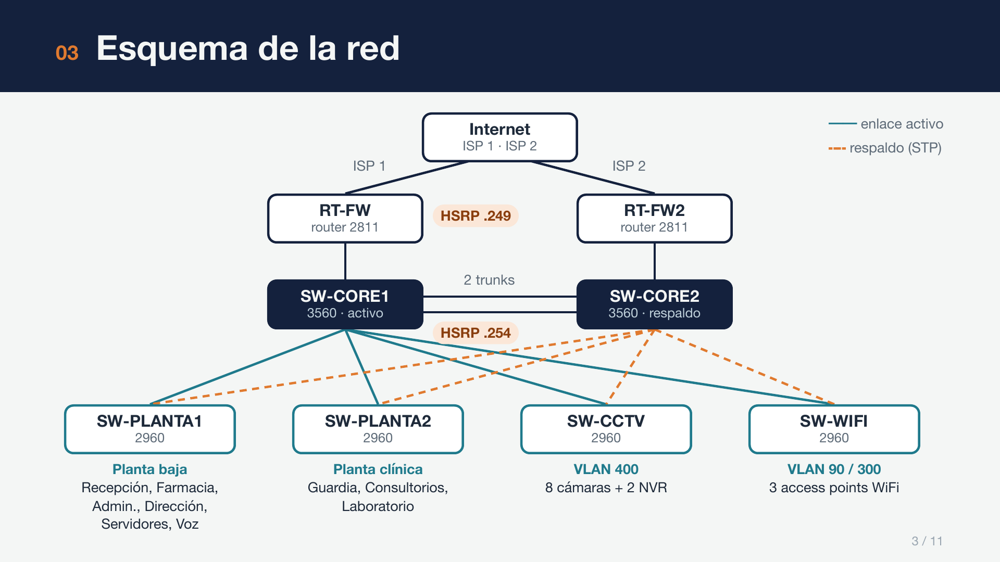
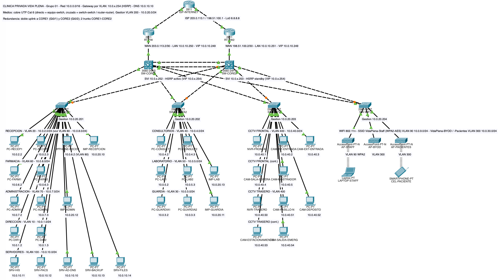

# Clínica Privada «Vida Plena» — Propuesta técnica de red

Segundo Parcial · Comunicaciones y Redes · Escuela Da Vinci · Grupo 01 · Illia Krauchanka

Red para una clínica de 2 plantas: núcleo colapsado redundante (2 × 3560), 4 switches de acceso (2960), 2 routers 2811 con 2 ISP, 13 VLAN, HSRP, Rapid PVST+, ACL, port-security y DHCP snooping. Simulada en Cisco Packet Tracer 9.0.1.

📊 **Presentación:** [VidaPlena_Presentacion.pdf](presentacion/VidaPlena_Presentacion.pdf) · 🎤 **Guion (5 min):** [guion.md](presentacion/guion.md)

Diagrama completo en Packet Tracer

## Contenido

| Archivo | Descripción |
|---|---|
| `Grupo_01_Parcial2.pdf` / `.docx` | Documento completo de la propuesta |
| `Grupo_01_VidaPlena_Parcial2.pkt` | Topología en Packet Tracer (49 dispositivos) |
| `Grupo_01_Diagrama_PT.png` | Diagrama completo en Packet Tracer |
| `VidaPlena_configs/` | Configuración IOS de los 9 equipos de red y tablas de VLAN, IP y conexiones |
| `presentacion/VidaPlena_Presentacion.pdf` | Presentación de 11 diapositivas |
| `presentacion/guion.md` | Texto para presentar en 5 minutos |
| `presentacion/esquema_red.png` | Esquema simplificado de la red |
| `presentacion/slides.html` | Fuente HTML de la presentación |

## Resumen

- **Direccionamiento:** LAN 10.0.0.0/16 (clase A privada), /24 por VLAN; WAN /30 (clase C). IP estática en equipos cableados, DHCP solo en WiFi.
- **Enrutamiento:** estático; inter-VLAN en las SVI del núcleo; NAT/PAT en los routers.
- **STP:** Rapid PVST+, raíz SW-CORE1, PortFast + BPDU Guard.
- **WiFi:** VidaPlena-Staff (VLAN 90, WPA2-AES), VidaPlena-BYOD y VidaPlena-Pacientes (VLAN 300, solo Internet).
- **Voz:** VLAN 80, teléfono IP con PC detrás en un solo puerto.
- **Seguridad:** ACL de invitados, CCTV y WAN; port-security; DHCP snooping; SSH v2.
- **Alta disponibilidad:** HSRP en núcleo y routers (track de la WAN), doble uplink, 2 ISP.

> Las credenciales que aparecen en las configuraciones son de laboratorio.
